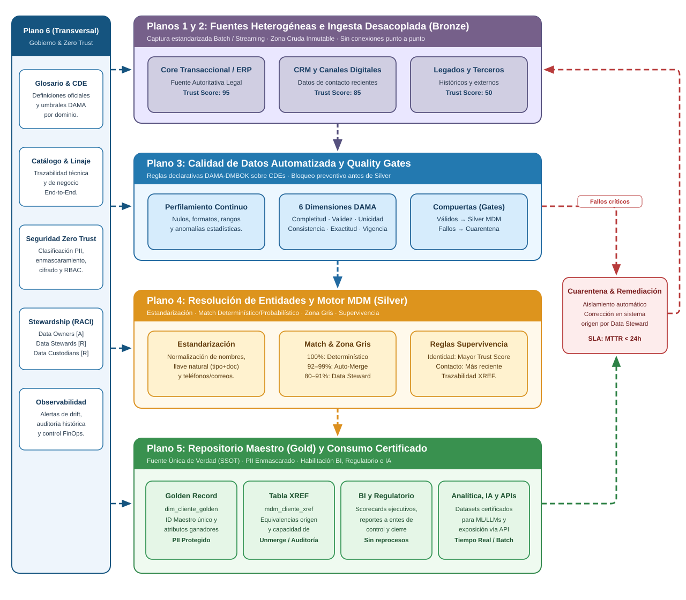
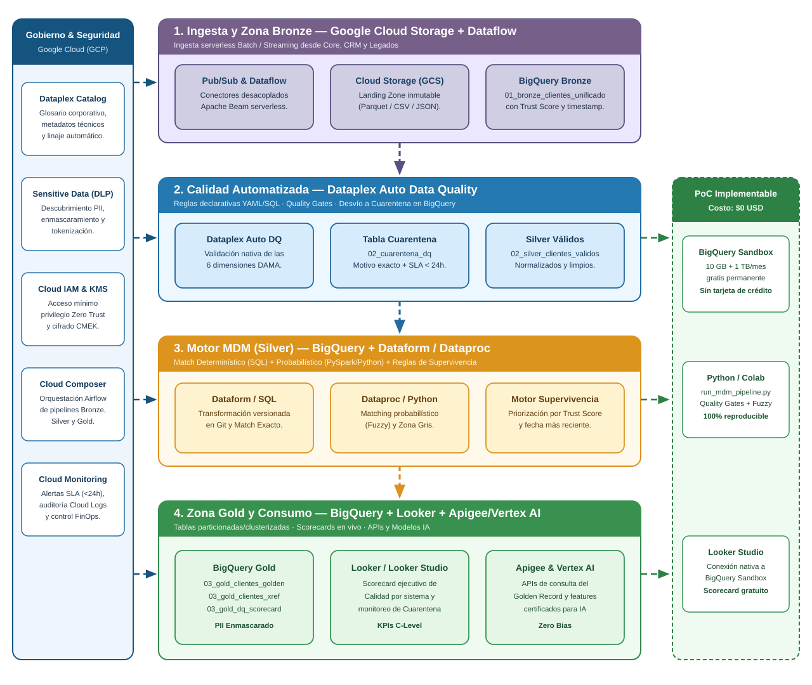

# Calidad de Datos y Master Data Management (MDM)

**Estándares de referencia:** DAMA-DMBOK2 (Capítulos 10 y 13) | TOGAF 10 | Seguridad Zero Trust  
**Enfoque:** Arquitectura Agnóstica → Caso de Negocio → Arquitectura de Referencia → Solución Cloud (GCP + Equivalencias Azure/AWS) → PoC Implementable ($0 USD)

---

## 1. Propósito Operativo y Modelo de Arquitectura Agnóstico

Mantener múltiples versiones de un mismo cliente, producto o proveedor repartidas entre el Core transaccional, el CRM y los sistemas legados genera sobrecostos operativos, reprocesos manuales en cierres financieros, incumplimientos regulatorios y modelos de Inteligencia Artificial sesgados.

Para resolver esta fragmentación independientemente del proveedor tecnológico, se define un **Modelo de Arquitectura Agnóstico de 6 planos funcionales**:

1. **Plano de Fuentes Heterogéneas:** Sistemas *Core* transaccionales, CRM, canales digitales y fuentes externas.
2. **Plano de Ingesta y Desacoplamiento:** Conectores estandarizados (*batch* y *streaming*) hacia una zona cruda inmutable, eliminando extracciones punto a punto.
3. **Plano de Calidad de Datos y Cuarentena:** Perfilamiento continuo, evaluación de las 6 dimensiones DAMA sobre Elementos Críticos de Datos (CDE) y desvío automático de fallos bloqueantes hacia Cuarentena con SLA de remediación en origen (**MTTR < 24h**).
4. **Plano de Resolución de Entidades (MDM):** Estandarización, emparejamiento determinístico/probabilístico, gestión de **Zona Gris (*Stewardship*)** y reglas de supervivencia por *Trust Score*.
5. **Plano de Repositorio Maestro y Consumo:** Almacén del **Golden Record** y su tabla de equivalencias (**XREF**), expuesto para BI, reportes regulatorios, APIs e IA.
6. **Plano Transversal de Gobierno y Seguridad Zero Trust:** Glosario corporativo, catálogo de metadatos, linaje *end-to-end*, clasificación/enmascaramiento PII y control de accesos por mínimo privilegio.

---

## 2. Caso de Uso de Negocio: Vista Única de Cliente Multi-Sistema

* **Escenario:** Una organización con operación multi-sistema gestiona información de clientes en tres repositorios desconectados: **Core Transaccional** (*Trust Score: 95*), **CRM Comercial** (*Trust Score: 85*) y **Sistema Legado** (*Trust Score: 50*).
* **Dolor de negocio:** Un mismo cliente existe duplicado con distintos formatos de nombre o identificación, datos de contacto desactualizados y contradicciones críticas (por ejemplo, estado `FALLECIDO` con producto activo o registros sin documento de identidad).
* **Objetivo:** Implementar controles automáticos de calidad en la ingesta, aislar registros corruptos en cuarentena, unificar duplicados mediante *Match & Merge* auditable y publicar un **Golden Record único por cliente** con trazabilidad reversible (`XREF`) y protección PII.

---

## 3. Arquitectura de Referencia Implementable (Medallion + MDM)

La arquitectura de referencia adopta el patrón **Lakehouse / Medallion** gobernado:

### 3.1 Matriz de Dimensiones de Calidad (Quality Gates DAMA-DMBOK)

| Dimensión DAMA | Regla Automatizada Aplicada sobre CDE Cliente | Umbral Meta | Acción ante Fallo |
| :--- | :--- | :---: | :--- |
| **Completitud** | `tipo_doc`, `num_doc` y `nombre_completo` no pueden ser nulos ni vacíos. | >= 99% | **Bloqueante** (Cuarentena) |
| **Validez** | `tipo_doc` en catálogo (`CC, NIT, CE, PAS`); `email` cumple RFC; `fecha_nacimiento` entre 1900 y hoy. | >= 99% | **Bloqueante** (Cuarentena) |
| **Unicidad** | Un único `mdm_golden_id` por entidad real tras resolución de duplicados. | 100% | **Envío a Match & Merge** |
| **Consistencia** | Un cliente con estado `FALLECIDO` no puede tener `tiene_producto_activo = SI`. | >= 98% | **Bloqueante** (Cuarentena) |
| **Exactitud** | Correspondencia verificada contra fuente autoritativa (Core / registros oficiales). | >= 98% | **Remediación en origen** |
| **Vigencia** | Selección del dato de contacto verificado más reciente en la ventana SLA. | >= 95% | **Monitoreo Scorecard** |

### 3.2 Umbrales de Match & Merge y Reglas de Supervivencia (*Survivorship*)

* **Emparejamiento Determinístico (Score = 100%):** Coincidencia exacta de llave natural (`tipo_doc + num_doc`). Fusión automática.
* **Emparejamiento Probabilístico — Auto-Merge (Score 92% – 99%):** Similitud difusa alta en nombre normalizado + fecha de nacimiento / teléfono. Fusión automática con auditoría en `XREF`.
* **Zona Gris — Revisión Humana (Score 80% – 91%):** Posible duplicado ambiguo enrutado a la bandeja del *Data Steward* (`zona_gris_stewardship.csv`).
* **Supervivencia de Atributos:**
  * *Identidad Legal, Estado y Segmento:* Gana la fuente con mayor **Trust Score** (`Core 95 > CRM 85 > Legado 50`).
  * *Correo Electrónico, Teléfono y Dirección:* Gana la **fecha de actualización verificada más reciente**.

---

## 4. Arquitectura de Solución Definitiva (Google Cloud) y Equivalencia Multi-Cloud

### 4.1 Selección de Google Cloud Platform (GCP)
Se seleccionó **GCP** como plataforma definitiva de implementación por su arquitectura *serverless* nativa, separación de almacenamiento y cómputo en BigQuery, integración directa de gobierno en Dataplex y **facilidad de validación en capa gratuita permanente (*BigQuery Sandbox + Looker Studio*) a $0 USD**.

### 4.2 Matriz de Equivalencia Multi-Cloud (GCP, Microsoft Azure y AWS)

Para garantizar portabilidad empresarial en organizaciones con acuerdos corporativos vigentes en otras nubes, cada capacidad se mapea directamente a **Microsoft Azure** y **AWS**:

| Plano / Capacidad | **Google Cloud (Definitiva)** | **Microsoft Azure (Equivalente)** | **AWS (Equivalente)** |
| :--- | :--- | :--- | :--- |
| **Zona Cruda (*Bronze*)** | Cloud Storage (GCS) | Azure Data Lake Storage Gen2 | Amazon S3 |
| **Ingesta y Orquestación** | Cloud Dataflow + Cloud Composer | Azure Data Factory / Fabric Pipelines | AWS Glue + MWAA / Step Functions |
| **Calidad y Cuarentena** | **Dataplex Auto Data Quality** | Databricks DLT Expectations / Fabric | **AWS Glue Data Quality (DQDL)** |
| **Motor MDM (*Silver*)** | BigQuery + Dataform / Dataproc | Azure Databricks (PySpark + Delta) | AWS Glue / EMR (PySpark + Iceberg) |
| **Repositorio *Gold* / XREF** | **BigQuery** | Microsoft Fabric Lakehouse / Synapse | Amazon Redshift / Athena |
| **Catálogo, Glosario y Linaje** | **Dataplex Universal Catalog** | **Microsoft Purview** | **AWS DataZone** + Glue Catalog |
| **Seguridad PII & Zero Trust** | Sensitive Data Protection (DLP) + IAM + KMS | Purview Info Protection + Entra ID + Key Vault | Amazon Macie + Lake Formation + KMS |
| **Scorecard Ejecutivo** | **Looker / Looker Studio** | **Power BI** | Amazon QuickSight |

---

## 5. Solución Implementable Sin Costo (PoC $0 USD)

Para respaldar la arquitectura con ejecución técnica verificable sin costos de infraestructura, la subcarpeta **[`poc-calidad-mdm/`](./poc-calidad-mdm/README_POC.md)** incluye la implementación completa y reproducible en **dos modos gratuitos**:

1. **En la Nube (Google BigQuery Sandbox + Looker Studio — $0 USD, sin tarjeta):** Script nativo [`src/bigquery_mdm_sql.sql`](./poc-calidad-mdm/src/bigquery_mdm_sql.sql) listo para ejecutar las capas Bronze, Cuarentena, Silver, Gold, XREF y Scorecard.
2. **En Local / Google Colab (Python):** Pipeline [`src/run_mdm_pipeline.py`](./poc-calidad-mdm/src/run_mdm_pipeline.py) ejecutado sobre 24 registros sintéticos multi-sistema (Core, CRM y Legado).

### Resultados Verificados de la Ejecución de Referencia
* **24 registros ingresados (Bronze)** $
ightarrow$ **19 aprobados (79.17% calidad inicial)** y **5 bloqueados en Cuarentena** ([ver rechazos](./poc-calidad-mdm/outputs/cuarentena_rechazos.csv)).
* **7 duplicados consolidados** automáticamente (determinísticos y probabilísticos) $
ightarrow$ **12 Golden Records únicos** con PII enmascarado ([ver Golden Record](./poc-calidad-mdm/outputs/gold_clientes_golden_record.csv)) y trazabilidad completa ([ver XREF](./poc-calidad-mdm/outputs/gold_clientes_xref.csv)).
* **1 caso ambiguo enrutado a Zona Gris** para revisión del *Data Steward* ([ver Zona Gris](./poc-calidad-mdm/outputs/zona_gris_stewardship.csv)).
* **Reporte automático generado:** [`outputs/scorecard_calidad.md`](./poc-calidad-mdm/outputs/scorecard_calidad.md).

---

[Volver al Portafolio Principal](../README.md)
