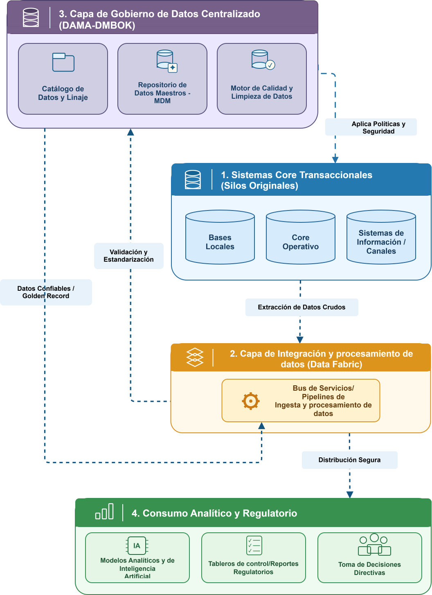

---

## Resumen Ejecutivo

La falta de gobernanza de datos y las arquitecturas fragmentadas son la principal causa de fallos regulatorios y sobrecostos operativos en entornos corporativos. 

Con más de 25 años de experiencia profesional en el ámbito tecnológico y en la gestión de datos corporativos, me especializo en estructurar el Gobierno de Datos y la Arquitectura de Información. Integro la visión estratégica del negocio utilizando diferentes marcos de referencia (TOGAF) con las mejores prácticas internacionales de gestión del dato (DAMA-DMBOK) para transformar silos de información en activos confiables y el uso y explotación de la información (Analítica/Inteligencia Artificial) de manera segura y listos para la toma de decisiones directivas. 

### Core Competencies
- **Gobierno de Datos:** DAMA-CDMP, Master Data Management (MDM), Calidad de Datos, Linaje y Metadatos.
- **Arquitectura Empresarial:** TOGAF 10, Data Fabric, Modelado Conceptual y Lógico.
- **Orquestación y Ecosistemas:** Interoperabilidad de sistemas Core, (ERPs/CRMs) hacia repositorios centralizados.
- **Gestión Directiva:** Formación de Comités de Gobierno, definición de roles (Data Stewards/Owners) y cumplimiento regulatorio.
---
## Arquitectura de Referencia: Ecosistema de Gobierno y MDM

El siguiente modelo ilustra mi enfoque arquitectónico agnóstico para resolver el caos de datos corporativos. Este diseño estandariza la extracción desde cualquier sistema transaccional (Core Bancario, Seguros, Retail, ERP) y lo somete a una estricta capa de Gobierno antes de su consumo.

---
## Data Governance Framework (Metodología Operativa)

Para que la arquitectura tecnológica funcione, implemento un marco de trabajo basado en procesos y personas (Framework DAMA), asegurando la adopción organizacional y el retorno de inversión.

### 1. Estructura Organizacional de Datos
* **Comité Ejecutivo de Datos:** Acompañamiento a la alta gerencia (C-Level) para alinear las iniciativas de datos con los objetivos de rentabilidad y cumplimiento del negocio.
* **Definición de Roles:** Asignación y capacitación de *Data Owners* (responsables de negocio) y *Data Stewards* (custodios técnicos y operativos) para garantizar la responsabilidad sobre la información crítica.

### 2. Gestión de Datos Maestros (Master Data Management - MDM)
* Identificación de las entidades críticas del negocio (Ej. Clientes, Productos, Empleados).
* Construcción del *Golden Record* (Registro Único de Verdad) para eliminar duplicidades y resolver conflictos entre los sistemas operativos.

### 3. Aseguramiento de Calidad y Seguridad
* Definición de métricas de calidad (Completitud, Exactitud, Oportunidad, Consistencia).
* Implementación de políticas de privacidad y control de accesos basados en roles, asegurando el cumplimiento de normativas locales e internacionales de protección de la información.
---

## Proof of Work: Impacto de Negocio (ROI)

* **Confiabilidad Corporativa:** En despliegues recientes para ecosistemas corporativos tipo holding, la estructuración de lineamientos centralizados de MDM y gobierno de datos logró incrementar la **confiabilidad de la información en más de un 60%**.
* **Eficiencia Operativa:** Reducción drástica de incidentes de interoperabilidad técnica al estandarizar herramientas, diccionarios de datos y marcos de trabajo a nivel transversal.
* **Aceleración Analítica:** Al entregar datos limpios y gobernados, los equipos de desarrollo y ciencia de datos aceleraron sus tiempos de entrega de productos analíticos en más de un **80%**.
---
---

## 📂 Artefactos y Documentación del Portafolio

* **[01. Marco Operativo y Política de Gobierno de Datos](./01-framework-gobierno/README.md):** Estructura de comités, matriz RACI, lineamientos de seguridad Zero Trust, KPIs de impacto y decisiones pragmáticas de implementación.

* **[02. Calidad de Datos y Master Data Management (MDM)](./02-calidad-y-mdm/README.md):** Modelo de arquitectura agnóstico (6 planos), caso de uso de Vista Única de Cliente, arquitectura de referencia Medallion + MDM, solución en Google Cloud (con equivalencias en Azure y AWS) y **[PoC ejecutable a $0 USD](./02-calidad-y-mdm/poc-calidad-mdm/README_POC.md)**.
